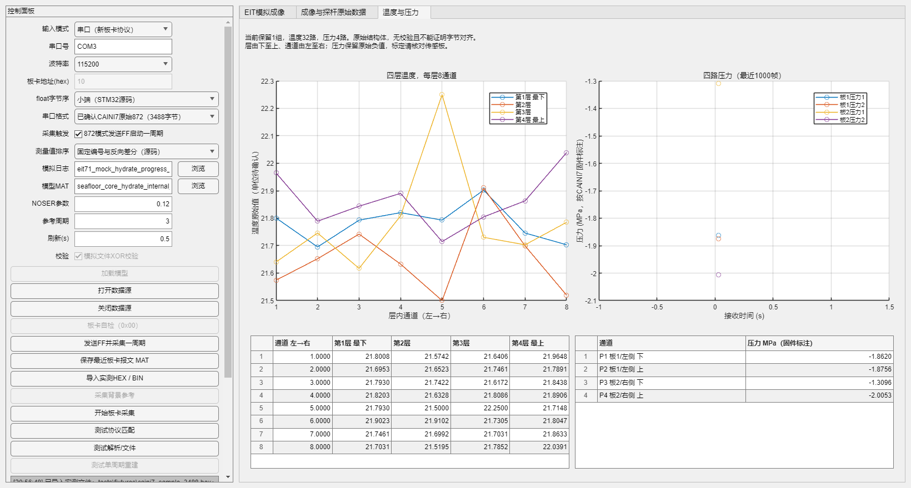

# CAINI7 71电极 EIT MATLAB 上位机

适配最终 CAINI7 下位机的 MATLAB 上位机：发送单字节 `FF` 启动采集，接收并解析 **3488 字节 / 872 个小端 float32**，显示电测量、四层温度和四路压力，并支持实测 HEX/BIN 导入和结果导出。



## 快速启动

已在 MATLAB R2023a 上完成离线协议和界面测试。下载仓库后，在 MATLAB 中进入仓库根目录：

```matlab
eit71_noser_upper_pc_app
```

默认串口格式为 CAINI7 raw872、小端、115200 / 8N1。设置实际 COM 口并打开数据源，点击“发送FF并采集一周期”。下位机扫描本身有约21秒以上固定延时，上位机默认等待60秒；不会在等待时重复触发。

无需硬件即可查看仓库内的真实样例：

```matlab
eit71_noser_upper_pc_app(fullfile(pwd,'tests','fixtures','caini7_sample_3488.hex'))
```

也可以在界面点击“导入实测HEX / BIN”。

## 数据结构

下位机直接发送 packed 结构体，依次为：

| 字段 | float数量 | 1基字节位置 |
| --- | ---: | --- |
| `eit[4][16][13]` | 832 | 1–3328 |
| `temp[4][8]` | 32 | 3329–3456 |
| `pressure[4]` | 4 | 3457–3472 |
| `main_voltage[4]` | 4 | 3473–3488 |

这3488字节没有额外帧头、长度字段、状态字或校验码。层由下至上，层内通道由左至右。实际差分计算为 `V(i+1)-V(i)`，按固定电极编号顺序排除接触激励电极的3对，而不是照循环起点重新排列。

探杆四组局部电极组合分别为：`1,4,2,3`、`2,5,3,4`、`3,6,4,5`、`4,7,5,6`。其值是 ADC 端峰峰值 Vpp。压力按固件打印标注为 MPa，原始负值不会被截断或取绝对值；物理单位和标定应由采集板定义确认。

## 独立解析和导出

```matlab
[data, report] = read_eit71_board_capture(fullfile('tests','fixtures','caini7_sample_3488.hex'));
data.eit_by_layer        % 4×16×13：层、激励、测量
data.temperature_layers % 4×8：层、通道
data.pressure           % 4×1
data.seven_electrode    % 4×1，ADC Vpp

files = export_eit71_board_capture(fullfile('tests','fixtures','caini7_sample_3488.hex'));
```

导出目录为 `caini7_capture_decoded`，包含完整 MAT、原始 BIN、分组 CSV 和全部872值的 HEX/字节索引。导入时严格检查单组长度和 HEX 格式，不自动补零、裁剪或修改符号。

已生成的拆分示例见 [examples/caini7_capture_decoded](examples/caini7_capture_decoded)，详细解释见 [3488字节实测报文拆分说明](examples/caini7_capture_decoded/3488字节实测报文拆分说明.md)。

## 验证

这两项测试不需要真实串口、EIDORS或大型模型文件：

```matlab
test_eit71_board_protocol
test_eit71_caini7_capture
```

覆盖真实3488字节样例、字段偏移、大小端、全部分包位置、FF触发、超时、非法文件和实际GUI导入路径。测试需要可用的 MATLAB 图形环境。

`test_eit71_app_smoke` 还会运行旧模型的模拟 NOSER 重建，需要额外准备下节的模型 MAT；无此文件时不能完成该测试。

## 旧模拟成像和大型模型

旧 EIT1 模拟日志、模拟日志生成脚本及模拟成像入口保留。它们需要将原有 `seafloor_core_hydrate_internal_probe_eit_result.mat` 放在仓库根目录。该文件约758 MB，未包含在源码仓库内。

当前旧 Jacobian 有6700行，而新硬件每周期为836个电测量值。此版本完成接收、拆分、显示与保存；真实硬件 NOSER 成像仍需匹配的新 Jacobian、电流和模拟链路增益标定。不要将836值填零或裁剪后套用旧模型。

## 固件配置

最终下位机源码为外部 `CAINI_Project_7_RS232_2` 工程，本仓库只收录上位机。

- UART7接收首字节 `0xFF` 后开始一轮采集。
- 实际二进制发送需启用 `COND_SEND_RAW=1`；`0` 为调试文本输出。
- 本地“停止”仅停止接收，固件没有取消指令；再次触发前应等上一周期结束。
- 原始结构体无校验；字节数正确和数值有限不代表物理标定或链路误码已被校验。

源码证据及样例核验见 [CAINI7最终协议核验](CAINI7最终协议核验.md)，完整操作见 [使用说明](71电极EIT_NOSER上位机使用说明.md)。

## 打包

```matlab
build_eit71_noser_upper_pc_app
```

需要安装并许可 MATLAB Compiler。默认生成图形界面 EXE 和联网 Runtime 安装包，分别位于 `build_eit71_noser_app/application` 与 `installer_web`。目标电脑无需安装 MATLAB；安装包会下载免费的匹配版 MATLAB Runtime。

支持 `build_eit71_noser_upper_pc_app('installer')` 捆绑离线 Runtime，也支持第二个参数指定外部大型模拟模型路径。EXE 和安装包通过 GitHub Releases 分发，源码仓库不保存二进制或 Runtime。操作及验证范围见 [Windows EXE 使用说明](docs/Windows_EXE使用说明.md)。
